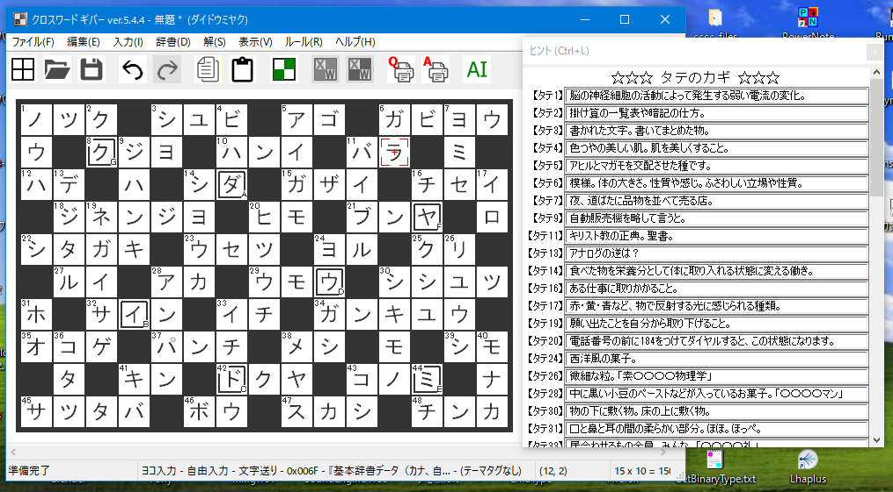

# XWordGiver by katahiromz

## What's this?

"XWordGiver" (pronouncing as "crossword giver") is a Windows software to generate crossword data.

It was devised not merely to generate crossword data, but with careful consideration of what constitutes highly productive crossword creation.

## Usage

### How to choose Policy

1. Choose "Policy Preset" from "Policy" menu. You can specify multiple policy.
2. Choose "What's the policy?" if you don't know XWordGiver's policy.

### How to choose a dictionary

Use "Dictionary" menu.

### If you just want to make something:

1. First, please choose some "policy" and a "dictionary".
2. In the "File" menu, select "Generate crossword..." and click the "Generate" button. The size should not be too greedy.

### If you want to generate from a block pattern:

1. First, please choose some "policy" and a "dictionary".
2. Select "Generate from block pattern..." from the "File" menu, click on the pattern of your choice, and press the "Generate" button.

### If you want to create the block pattern by yourself:

1. First, please choose some "policy" and a "dictionary".
2. Use the arrow keys and space bar to create a block pattern. Alternatively, you can generate a block pattern from the "Help" menu.
3. Select "Find a solution (without adding blocks)" from the "Solution" menu.

### If you want to create from specific words:

1. Gather some relatively long words, rewrite them in Katakana or Alphabet, and save them in Excel or Notepad.
2. Select "Generate from words..." from the "File" menu.
3. Paste the words into the dialog and click the "Generate" button.

### If you want to create the whole board manually:

1. First, please choose some "policy" and a "dictionary".
2. Repeat typing the arrow keys, spacebar, and letters.
3. Once all the cells are filled, select "Find a solution (without adding blocks)" from the "Solution" menu.

### If you want to create a skeleton:

1. Select an appropriate "dictionary," and choose "Skeleton policy" from the "Rule presets."
2. Select "Skeleton view" from the "View" menu to make the black squares transparent.

### Adding clues to the board

1. Ensure that the entire board is filled; if any cells are empty, please fill them in.
2. Select "Find a solution (without adding blocks)" from the "Solution" menu.
3. The "Clues" window will appear.
4. Edit the clues on the "Clues" window.

### If the board is locked and cannot be edited

Selecting "Delete clues and unlock board" from the "Solution" menu will unlock the board.

## NOTICE

- It is calculated using heuristic methods, so it may take some time.
- If there are not enough or too many combinations, you may fail or not finish.
- The larger the size, the longer it will take. Please be patient during the calculation.
- There are machine differences in computing performance.
- The quality of the algorithm and dictionary data is NOT GUARANTEED.
- Sorry to say, this program is optimized for Japanese crossword generation. Some patterns may be improper for Latin crossword generation. I struggle, struggle, struggle. You earn, earn, earn!

## About LOOKS Information

The LOOKS files and image files found within the "..._files" folder, which is created alongside the main file when saving, are used to define the appearance of a crossword puzzle, including elements such as colors, line thicknesses, and fonts.
If you only need the puzzle data itself and are not concerned with its visual presentation, you do not need these LOOKS files.
You can copy the visual style by dragging and dropping a LOOKS file into the main window (or other appropriate areas).

## Requirements

- Windows Vista/7/8.1/10/11.
- Intel Core i5 or later.
- Multicore.
- Main memory 4GB+.

## License

"XWordGiver" is currently paid shareware. Please refer to [LICENSE.txt](LICENSE.txt) for details.

## Contact

katayama.hirofumi.mz@gmail.com
